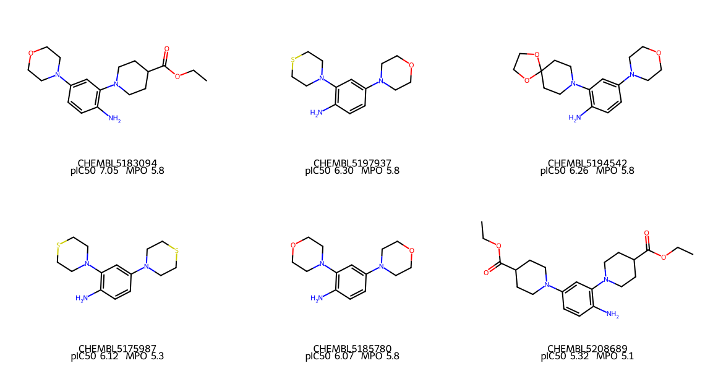

# Candidate dossier

Generated by `src/report_candidates.py`.

The compounds that are both **non-covalent** and **predicted to reach the brain**.
Every other table in this project reports aggregates; this one says what each
individual compound is and what is wrong with it.

> **None of these has been tested by this project.** Potency values are published
> measurements; everything else is predicted from structure.

Docking poses come from **7FQI**. A pose is only evidence about
inhibition if it sits in the active site, so the distance from each pose to the
catalytic thiol (Cys189) is reported with it.

## 1. CHEMBL5183094

`CCOC(=O)C1CCN(c2cc(N3CCOCC3)ccc2N)CC1`

| | |
|---|---|
| Measured potency | pIC50 **7.05** (89 nM) |
| Molecular weight | 333 |
| cLogP / TPSA | 1.88 / 68 A2 |
| CNS MPO | 5.83 of 6 |
| BBB rules met | 6/6 |
| Docking score | -5.22 kcal/mol |
| Pose to catalytic thiol | 8.1 A — **outside the active site** |

**Pose contacts:** Tyr41, Arg44, His148, Tyr217, Ala218, Cys219, Thr227, Tyr228, Trp232, Thr264

The pose contacts the catalytic dyad itself (His148), which is what a real inhibitor has to do.

**Liabilities**

- structural alert: aniline
- docked pose sits 8.1 A from the catalytic thiol, so its score does not describe active-site binding
- potency rests on a single published measurement

## 2. CHEMBL5197937

`Nc1ccc(N2CCOCC2)cc1N1CCSCC1`

| | |
|---|---|
| Measured potency | pIC50 **6.30** (498 nM) |
| Molecular weight | 279 |
| cLogP / TPSA | 1.66 / 42 A2 |
| CNS MPO | 5.83 of 6 |
| BBB rules met | 6/6 |
| Docking score | -4.73 kcal/mol |
| Pose to catalytic thiol | 8.6 A — **outside the active site** |

**Pose contacts:** Tyr41, Asn42, Arg44, His148, Tyr221, Ser226, Thr227, Tyr228

The pose contacts the catalytic dyad itself (His148), which is what a real inhibitor has to do.

**Liabilities**

- structural alert: aniline
- docked pose sits 8.6 A from the catalytic thiol, so its score does not describe active-site binding
- potency rests on a single published measurement

## 3. CHEMBL5194542

`Nc1ccc(N2CCOCC2)cc1N1CCC2(CC1)OCCO2`

| | |
|---|---|
| Measured potency | pIC50 **6.26** (547 nM) |
| Molecular weight | 319 |
| cLogP / TPSA | 1.45 / 60 A2 |
| CNS MPO | 5.83 of 6 |
| BBB rules met | 6/6 |
| Docking score | -5.26 kcal/mol |
| Pose to catalytic thiol | 7.2 A — **outside the active site** |

**Pose contacts:** Tyr41, Arg44, Ala218, Tyr221, Ser226, Tyr228

**Liabilities**

- structural alert: aniline
- docked pose sits 7.2 A from the catalytic thiol, so its score does not describe active-site binding
- potency rests on a single published measurement

## 4. CHEMBL5175987

`Nc1ccc(N2CCSCC2)cc1N1CCSCC1`

| | |
|---|---|
| Measured potency | pIC50 **6.12** (757 nM) |
| Molecular weight | 295 |
| cLogP / TPSA | 2.38 / 32 A2 |
| CNS MPO | 5.27 of 6 |
| BBB rules met | 6/6 |
| Docking score | -4.60 kcal/mol |
| Pose to catalytic thiol | 8.8 A — **outside the active site** |

**Pose contacts:** Tyr41, Asn42, Arg44, His148, Ser226, Thr227, Tyr228

The pose contacts the catalytic dyad itself (His148), which is what a real inhibitor has to do.

**Liabilities**

- structural alert: aniline
- docked pose sits 8.8 A from the catalytic thiol, so its score does not describe active-site binding
- potency rests on a single published measurement

## 5. CHEMBL5185780

`Nc1ccc(N2CCOCC2)cc1N1CCOCC1`

| | |
|---|---|
| Measured potency | pIC50 **6.07** (844 nM) |
| Molecular weight | 263 |
| cLogP / TPSA | 0.94 / 51 A2 |
| CNS MPO | 5.83 of 6 |
| BBB rules met | 5/6 |
| Docking score | -5.02 kcal/mol |
| Pose to catalytic thiol | 3.6 A — **in the active site** |

**Pose contacts:** Tyr41, Arg44, His45, Snn147, His148, Cys189, Ser215, Ser216, Tyr217, Ala218, Tyr228, Asp231

The pose contacts the catalytic dyad itself (His148, Cys189), which is what a real inhibitor has to do.

**Liabilities**

- structural alert: aniline
- potency rests on a single published measurement

## 6. CHEMBL5208689

`CCOC(=O)C1CCN(c2ccc(N)c(N3CCC(C(=O)OCC)CC3)c2)CC1`

| | |
|---|---|
| Measured potency | pIC50 **5.32** (4831 nM) |
| Molecular weight | 404 |
| cLogP / TPSA | 2.83 / 85 A2 |
| CNS MPO | 5.11 of 6 |
| BBB rules met | 6/6 |
| Docking score | -5.67 kcal/mol |
| Pose to catalytic thiol | 6.2 A — **outside the active site** |

**Pose contacts:** Tyr41, Arg44, His148, Tyr217, Ala218, Cys219, Tyr220, Tyr221, Ser226, Thr227, Tyr228, Trp232

The pose contacts the catalytic dyad itself (His148), which is what a real inhibitor has to do.

**Liabilities**

- structural alert: aniline
- docked pose sits 6.2 A from the catalytic thiol, so its score does not describe active-site binding
- potency rests on a single published measurement

## What to do with these

1. **Test them.** Six compounds against recombinant legumain is a small experiment
   and it converts every prediction above into evidence.
2. **Run an Ames test on the series first.** All six share an ortho-phenylenediamine,
   a recognised genotoxicity alert, and for a drug taken over years that question
   comes before potency.
3. **Treat the docking scores carefully.** Most of these poses sit outside the
   active site, which means the score is describing something other than
   inhibition for those compounds.

The one compound whose pose does sit in the active site, CHEMBL5185780, is also
the fragment resolved in the 5LUA crystal structure, so its binding mode is known
rather than predicted. That makes it the sensible starting point for any
structure-based optimisation, despite being far from the most potent.
