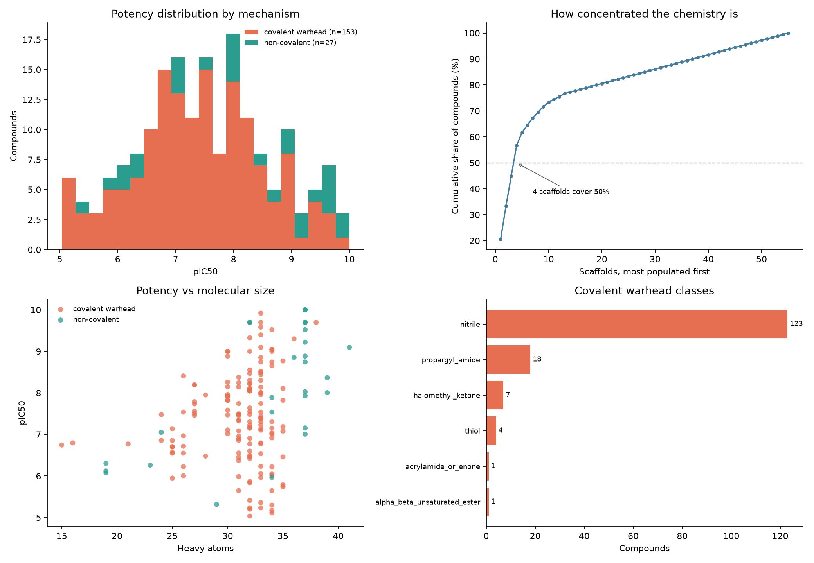

# The LGMN dataset, and what it can support

Generated by `src/data/explore.py`.

## Size

- Compounds with a usable human biochemical potency: **180**
- Unique Bemis-Murcko scaffolds: **55**
- Scaffolds represented by a single compound: **42**
- Scaffolds covering half the dataset: **4**

Those 4 scaffolds carrying half the compounds is the number that decides how
the models must be evaluated. It means a random train/test split will almost
always put close analogues of a test compound into training, and measure recall
of a series rather than prediction of a new one.
- pIC50 range: **5.03 to 10.00** (median 7.47, sd 1.18)

This is a small dataset by any QSAR standard, and it is not 180
independent observations: the chemistry is concentrated, so a model that
looks accurate under a random split is mostly recognising compound series
it has already seen. That is why every reported metric in
`docs/RESULTS.md` comes from a scaffold-grouped split.

## Mechanism

- Carrying a covalent warhead: **153** (85%)
- Non-covalent: **27**

Legumain is a cysteine protease, so this is expected rather than a sampling
artefact, but it constrains the whole project. Non-covalent docking scores
are not meaningful for 85% of the compounds, and covalent chemistry carries
selectivity and toxicity questions that a potency number does not capture.

### Warhead classes

| Warhead | Compounds |
|---|---|
| nitrile | 123 |
| propargyl_amide | 18 |
| halomethyl_ketone | 7 |
| thiol | 4 |
| acrylamide_or_enone | 1 |
| alpha_beta_unsaturated_ester | 1 |

The nitrile count dominates because the largest published series against this
target are electrophilic nitriles, which form a reversible thioimidate with
the catalytic cysteine -- the adduct resolved in 7FQI.

## What was discarded, and why

| Reason | Records |
|---|---|
| `endpoint_not_a_concentration` | 87 |
| `assay_organism_not_human` | 4 |
| `replicate_spread_over_1.0_log` | 1 |

`endpoint_not_a_concentration` is mostly single-dose percent inhibition,
which cannot be converted to a comparable potency. `assay_organism_not_human`
is four Schistosoma mansoni measurements annotated against the human target
in ChEMBL.

## Cell-based records, kept separate

**74** human cell-based measurements are held in
`data/processed/lgmn_cellular.csv` rather than pooled with the enzymatic
data. Pooling them was the single largest data-quality problem found in
this project: it created 1-3 log unit 'replicate disagreement' for 30
compounds that was really the difference between inhibiting purified enzyme
and inhibiting it inside a cell. Separating them cut the number of compounds
with unusable labels from 31 to 1.

Those records are a permeability signal, not noise, and the gap between a
compound's enzymatic and cellular IC50 is worth analysing on its own.
