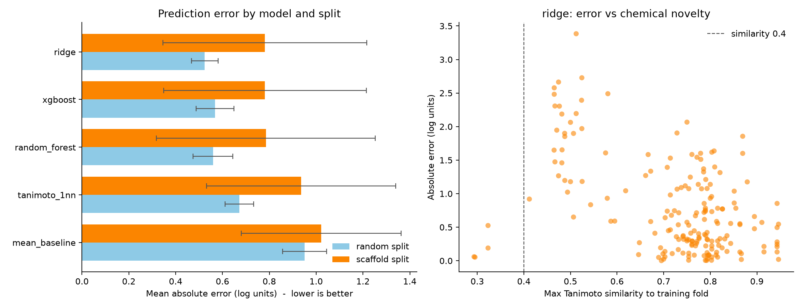

# Did expanding the dataset help?

Generated by `src/models/compare_datasets.py`.

The ChEMBL-derived set holds **180 compounds over 55 scaffolds**. Adding the
PubChem compounds absent from it takes that to **185 over 58**.

## Headline numbers, and why they mislead

Fold-by-fold performance on each dataset, the error bars being the point:

| Before | After |
|---|---|
|  |  |

| | Best model | MAE | R2 | Spearman |
|---|---|---|---|---|
| Before | random_forest (both) | 0.772 | -0.195 | 0.472 |
| After | ridge (both) | 0.780 | -0.204 | 0.489 |

The expanded set gives a higher error (0.780 against 0.772) and an R2 of -0.204 against -0.195.
Both remain negative: on unseen scaffolds neither model beats predicting the
training mean in squared error.

Scaffold-split folds on a set this size vary by about +/-0.48 log units
between themselves, so a difference of 0.009 in the mean carries no
weight. Comparing the per-fold scores directly gives **p = 0.98**, which is not significant.

This matters more than it looks, because an earlier version of this comparison
did show R2 crossing into positive territory. That run included four compounds
later found to be tautomer duplicates of compounds already in the training set.
Duplicates across folds leak the answer, and removing them removed the
improvement along with them. The apparent gain was the leak.

## Like-for-like, every configuration

The best configuration can change between runs for reasons unrelated to the data,
so each model is compared against itself.

| Model | Features | MAE before | MAE after | Change |
|---|---|---|---|---|
| tanimoto_1nn | descriptors | 0.941 +/- 0.394 | 0.935 +/- 0.404 | -0.006 |
| ridge | descriptors | 0.894 +/- 0.319 | 0.904 +/- 0.327 | +0.009 |
| random_forest | descriptors | 0.815 +/- 0.486 | 0.812 +/- 0.441 | -0.003 |
| xgboost | descriptors | 0.801 +/- 0.462 | 0.812 +/- 0.408 | +0.010 |
| tanimoto_1nn | morgan | 0.941 +/- 0.394 | 0.935 +/- 0.404 | -0.006 |
| ridge | morgan | 0.834 +/- 0.484 | 0.834 +/- 0.462 | -0.000 |
| random_forest | morgan | 0.806 +/- 0.440 | 0.785 +/- 0.399 | -0.021 |
| xgboost | morgan | 0.851 +/- 0.431 | 0.835 +/- 0.403 | -0.016 |
| tanimoto_1nn | both | 0.941 +/- 0.394 | 0.935 +/- 0.404 | -0.006 |
| ridge | both | 0.798 +/- 0.494 | 0.780 +/- 0.435 | -0.017 |
| random_forest | both | 0.772 +/- 0.477 | 0.785 +/- 0.468 | +0.014 |
| xgboost | both | 0.825 +/- 0.562 | 0.782 +/- 0.433 | -0.044 |

**9 of 12** configurations improved. If the direction were a
coin flip that would happen with probability 0.07.

Nearly every configuration moved the same way, which is more interesting than
any single comparison: a change too small to reach significance on magnitude can
still be real if independent models agree on its direction.

**That sign-test p-value should not be read at face value.** It assumes the
configurations are independent samples, and they are emphatically not: all of
them see the same compounds, the same scaffold folds and largely overlapping
feature blocks, with two of the three algorithms being tree ensembles. Positively
correlated tests make a shared direction far more likely than chance would
suggest, so the true evidence is weaker than 0.073 implies -- how much
weaker is not quantifiable from these runs.

The defensible statement is the modest one: the direction is consistent and the
magnitude is inside fold-to-fold noise, which is what adding 5% more data to a
small set should be expected to look like.

## What this means for the project

Adding 5% more compounds did not measurably improve the model, and nobody should
expect it to have. The useful conclusion is about scale: if nine compounds move
the needle this little, the gap between this dataset and a usable one is not
tens of compounds but hundreds.

It also settles the 'expand beyond ChEMBL' recommendation that this project had
been carrying as future work. The public record was checked, it yielded nine
usable compounds, and they were not enough. That recommendation should not be
repeated as though it were still untried.

The honest reading of both datasets is unchanged: the model ranks compounds
weakly and cannot predict absolute potency for unseen chemistry.
