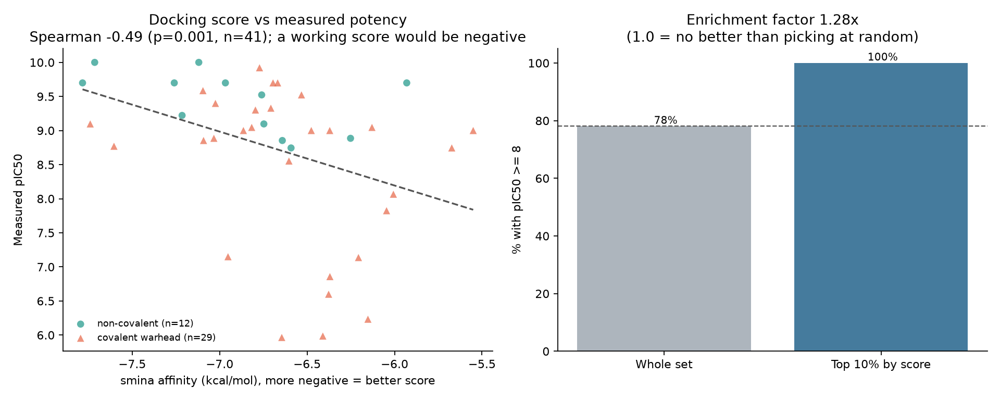

# Docking protocol: what it was validated to do

Generated by `src/report.py` from `results/docking/protocol_validation.csv`.

## Why validation comes first

A docking setup with a misplaced box, a damaged receptor or badly protonated
ligands still returns confident-looking scores for every compound, and nothing
in the output reveals the problem. Redocking a ligand whose pose is known from
crystallography is the one available check. Convention takes RMSD below 2.0 A
as success.

Two numbers are reported per template, and the difference between them says
what kind of failure occurred:

- **top-pose RMSD** is the prospective number. In a real screen the top-scored
  pose is what you act on, with no crystal structure to check it against.
- **best-of-20 RMSD** separates sampling from scoring. If the best pose is
  right but the top pose is not, the search found the binding mode and the
  *scoring function* could not rank it first. If no pose is right, the search
  never found it -- a box, receptor or ligand-preparation fault.

## Results

| PDB | Ligand | Res (A) | Atoms | Covalent in crystal | Top RMSD | Best RMSD | Best at rank | Verdict |
|---|---|---|---|---|---|---|---|---|
| 7FQI | WSN | 1.45 | 36 | yes | 2.24 | 1.47 | 3 | scoring could not rank it |
| 7FQK | WS9 | 1.97 | 36 | yes | 2.53 | 2.53 | 1 | fail |
| 5LUA | 5KN | 2.0 | 19 | no | 9.52 | 2.29 | 4 | fail |
| 5LUB | 3Y7 | 2.1 | 16 | no | 4.85 | 2.73 | 3 | fail |
| 7FQH | WR9 | 2.18 | 31 | yes | 7.30 | 1.02 | 5 | scoring could not rank it |

## What this licenses

No template reproduced its pose as the **top-ranked** result, but 2
found it somewhere in the top 20. That is a scoring-function failure rather
than a broken setup: the search locates the binding mode and then ranks a
decoy above it.

The obvious inference is that these scores cannot rank compounds either: the
same function that misranks poses of one ligand should misrank ligands. That
inference is testable, because every compound here has a published potency, and
the section below tests it rather than assuming it. The answer turns out to
depend on mechanism, so the inference is right for most of the dataset and
wrong for the part that matters most to this project.

### Fragments redock worse, as expected

Mean top-pose RMSD for the 2 fragment ligands (<25 heavy atoms) is
7.18 A, against 4.02 A for the 3 drug-sized ones.
Small, weakly-bound ligands make shallow contact and empirical scoring
functions struggle to distinguish their real pose from alternatives. This is
why the box is sized from the ligand rather than left wide: redocking 5KN
into 5LUA put the top pose 10.4 A away with 8 A of padding, and 1.4 A was
reachable at 3 A.

## Selected template

**7FQI / WSN** at 1.45 A (36 heavy atoms).

- top-pose RMSD 2.24 A
- best-of-20 RMSD 1.47 A
- validated prospectively: **no**

This ligand is **covalently bound** in the crystal. Redocking it
non-covalently tests the pocket shape, the box and the preparation, which
is what the protocol needs to be trusted for; it does not test the bond
formation, which the scoring function does not model at all.

## Does the score actually track potency?

The redocking result above predicts that it should not: a function that cannot
rank poses of one ligand has little reason to rank ligands. But every compound
here has a published pIC50, so the question can be measured instead of argued.

Scored compounds: **180**, affinity -7.78 to -4.34 kcal/mol.

A working scoring function gives a **negative** correlation: a more negative
affinity should mean a more potent compound.

| Subset | n | Spearman | p | Direction |
|---|---|---|---|---|
| all scored compounds | 180 | -0.303 | 3.63e-05 | correct |
| pose contacts catalytic thiol | 172 | -0.255 | 0.000752 | correct |
| non-covalent only | 27 | -0.676 | 0.00011 | correct |
| covalent only | 153 | -0.236 | 0.00329 | correct |

### Is it just molecular size?

Vina-family scores grow more negative with ligand size, and in this dataset
potency also rises with size (rho +0.27). A score that merely tracked size would
therefore produce a convincing correlation with potency while knowing nothing
about binding.

- affinity vs heavy atoms: **-0.32**
- size vs potency: **+0.27**
- affinity vs potency, controlling for size: **-0.238** (p=0.00131)

The relationship survives the control, so it is not simply a molecular
weight effect. That is a more positive result than the redocking validation
predicted, and worth stating plainly in both directions: the scoring
function cannot place a ligand correctly in the pocket, yet retains some
ability to tell potent compounds from weak ones across a series.

### Split by mechanism, the picture changes

The whole-set number averages two populations the scoring function treats
differently. It has no term for covalent bond formation, so for the 85% of
these compounds that inhibit covalently, a large part of potency is set by a
reaction rate it cannot see. Controlling for ligand size within each group:

| Subset | n | Partial Spearman | p | Survives size control |
|---|---|---|---|---|
| Non-covalent | 27 | -0.497 | 0.00828 | yes |
| Covalent | 153 | -0.222 | 0.00573 | yes |

Both survive, and the difference in strength is the result. The non-covalent
relationship is about 2.2 times stronger, which is what the physics
predicts: where the scoring function models the whole binding event it does
better than where it models only the part preceding a chemical reaction.

That covalent compounds show any relationship at all is worth stating, because
it was not obvious. The most likely reading is that the score is measuring how
well the fragment occupies the pocket before it reacts, and that compounds
which sit well also tend to react efficiently. The score correlates with
potency without explaining it.

**This corrects an earlier conclusion in this project.** At 101 of 180
compounds the covalent subset showed no size-controlled relationship, and the
shortlist ranking was changed to ignore docking for those compounds. The full
data overturned that, and the change was reverted. A result from half a
dataset can look settled and still be wrong.

### What a top slice would actually give you

Virtual screening is used to pick a top slice, not to predict potencies, so
enrichment matters as much as correlation. 'Active' here means the top
quartile of measured potency (pIC50 >= 8.23); a fixed 100 nM cut is
meaningless on a set of published inhibitors where most compounds clear it.

- Top 10% by docking score: **39%** are top-quartile potent
- Whole set: **25%**
- Enrichment factor: **1.56x** (1.0 would be no better than random)

## The deeper limitation

85% of the compounds in this dataset carry a covalent warhead. Their measured
potency is dominated by the rate of bond formation with Cys189, and a non-covalent
scoring function has no term for that. So for most of this dataset a docking
score is not a weak estimate of potency -- it is an estimate of a different
quantity (how well the fragment sits in the pocket before reacting). That is
worth knowing, and it is not what a screening score is usually read as.
