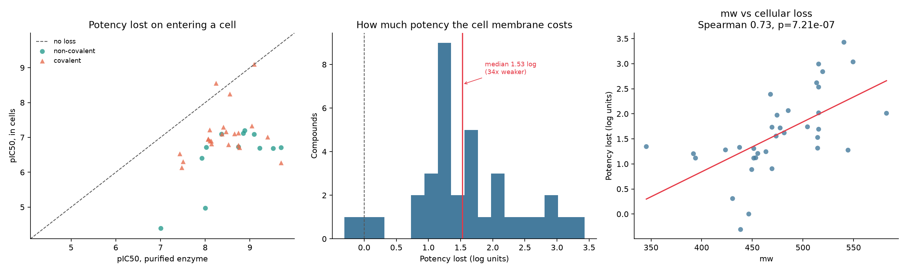

# Cellular permeability: what the paired assay data shows

Generated by `src/data/permeability.py`.

**35 compounds** were measured both against purified recombinant legumain
and inside HEK293-A cells. The difference between those two numbers is the
closest thing to experimental permeability evidence this project has without
running an experiment.

## The headline

- Median potency lost on entering a cell: **1.53 log units** (34-fold weaker)
- Compounds losing 10-fold or more: **30 of 35**
- Compounds that got *more* potent in cells: **1**

A HEK293 plasma membrane is a far easier barrier than the blood-brain barrier.
A compound that already loses most of its potency getting into an ordinary cell
in culture is not a realistic starting point for a CNS drug, whatever its
enzymatic IC50 says.

## What predicts the loss

Seven properties known to govern passive membrane permeability were tested
against the gap. They were chosen before looking, rather than by scanning
every descriptor until one reached significance, and p-values are Holm-adjusted
for testing several at once.

| Property | Spearman rho | p | p (Holm) | Significant |
|---|---|---|---|---|
| mw | +0.73 | 7.21e-07 | 4.33e-06 | yes |
| hba | +0.35 | 0.0382 | 0.191 | no |
| fsp3 | -0.31 | 0.0681 | 0.272 | no |
| tpsa | +0.30 | 0.0831 | 0.272 | no |
| clogp | +0.18 | 0.296 | 0.592 | no |
| rotb | +0.14 | 0.434 | 0.592 | no |

**mw** is the strongest relationship (rho +0.73, Holm p=4.33e-06): compounds with higher mw
lose more potency on entering a cell, which is the direction passive-diffusion
models predict.

## Does enzymatic potency translate into cells?

Partly, and inefficiently.

- Slope of cellular on enzymatic pIC50: **0.48** -- each log unit gained against the
  purified enzyme returns about 0.48 log in cells
- Spearman rho **0.29** (p=0.0912), Pearson r 0.38 (p=0.0224), n=35
- The 10 most potent enzyme inhibitors average 9.25 on enzyme and
  7.12 in cells; the 10 weakest average 7.76 and 6.25.
  So 1.49 log of enzymatic improvement bought 0.86 log in cells.

It is tempting to read the scatter as a hard ceiling, because every strong
enzyme inhibitor lands near pIC50 7 in cells. That overstates it. The honest
statement is that the relationship is real but weak and heavily attenuated,
and at n=35 the rank correlation is not significant.

The practical implication still holds either way: pushing enzymatic potency
further is a poor use of effort for this series compared with fixing whatever
stops the compounds reaching their target, since most of each gain is lost at
the membrane.

## Worst cellular drop-off

| ChEMBL ID | Enzyme pIC50 | Cell pIC50 | Lost (log) | Fold | TPSA | cLogP |
|---|---|---|---|---|---|---|
| CHEMBL5427662 | 9.70 | 6.27 | 3.43 | 2680x | 148 | 1.07 |
| CHEMBL5399981 | 8.00 | 4.97 | 3.04 | 1087x | 102 | 3.30 |
| CHEMBL5402155 | 9.70 | 6.71 | 2.99 | 985x | 128 | 1.81 |
| CHEMBL5415768 | 9.52 | 6.68 | 2.84 | 693x | 141 | 1.71 |
| CHEMBL5436014 | 7.01 | 4.39 | 2.62 | 416x | 102 | 3.02 |

## Smallest drop-off (the ones that travel best)

| ChEMBL ID | Enzyme pIC50 | Cell pIC50 | Lost (log) | TPSA | cLogP |
|---|---|---|---|---|---|
| CHEMBL5416023 | 8.24 | 8.55 | -0.31 | 126 | 1.49 |
| CHEMBL5406157 | 9.10 | 9.10 | 0.00 | 126 | 2.39 |
| CHEMBL5406826 | 8.55 | 8.24 | 0.31 | 116 | 2.26 |
| CHEMBL5394446 | 8.10 | 7.21 | 0.89 | 102 | 1.60 |
| CHEMBL5416142 | 7.43 | 6.53 | 0.90 | 102 | 1.94 |

These are worth more attention than their raw enzymatic potency suggests. A
compound that keeps its activity inside a cell has already cleared a barrier
that most of this chemical series does not.

## Caveats

- A cellular IC50 folds together permeability, efflux, serum binding, intracellular
  target concentration and compound stability. The gap is not a pure permeability
  measurement.
- HEK293 cells are not brain endothelium and have no tight junctions or the same
  efflux transporter profile. Passing here does not predict crossing the
  blood-brain barrier; failing here is the more reliable signal.
- Most pairs come from a small number of publications and chemical series, so
  these compounds are not independent observations.
