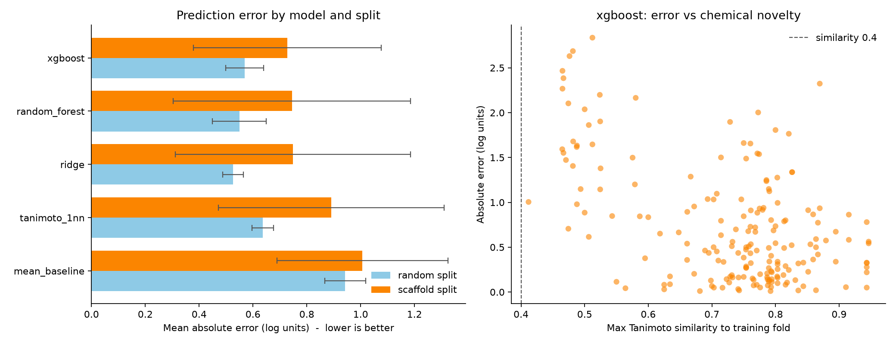

# Results

Generated by `src/report.py`. **Every result here is a computational prediction.**
Nothing in this project has been tested experimentally.

## The target

- Experimental structures of human legumain: **18**
- With the prodomain removed (mature enzyme): **17**
- Catalytic dyad found geometrically in every chain of every entry: **Cys189 / His148**

That the same pair falls out of all 18 independent structures is the check
that the right site was located; see `docs/TARGET.md` for the measured
geometry and why a distance cutoff cannot be used to identify it.

## The data

- Compounds with usable human biochemical potency: **180**
- Unique scaffolds: **55**
- Covalent warhead: **153** (85%)
- pIC50 5.03-10.00, median 7.47

See `docs/DATASET.md`. The one change that mattered most was separating
cell-based from enzymatic assays before aggregating replicates: pooling them
created 1-3 log 'disagreement' for 30 compounds that was really the
difference between inhibiting purified enzyme and inhibiting it inside a
cell. Fixing it cut unusable labels from 31 compounds to 1.

## What happens when these compounds meet a membrane

35 compounds were measured both on purified enzyme and inside
HEK293-A cells, which is the closest thing to experimental permeability
evidence available here without running an experiment.

- Median potency lost on entering a cell: **1.53 log units** (34-fold weaker)
- Losing 10-fold or more: **30 of 35**
- Molecular weight predicts the loss (Spearman 0.73, Holm-adjusted p=4e-6)

This is the central finding meeting independent evidence. The compounds are
large and polar because that is what binds an asparagine-recognising protease,
and the same properties cost them most of their potency at an ordinary cell
membrane. The blood-brain barrier is a considerably harder one.

See `docs/PERMEABILITY.md`.

## Can potency be predicted?

Modestly, for ranking. Not at all, for absolute potency on new chemistry.

| Split | Best model | MAE (log units) | R2 | Spearman |
|---|---|---|---|---|
| scaffold | random_forest (both) | 0.772 | -0.19 | 0.47 |
| random | ridge (both) | 0.546 | 0.63 | 0.75 |
| scaffold | predict the training mean | 1.030 | - | - |

Three things to read from this:

1. The scaffold-split model beats predicting the mean by 25%, so there is
   some transferable signal. It is not nothing.
2. **R2 is negative** (-0.19). The model is worse than the mean in
   squared error while better in absolute error, which means a few large
   misses dominate. It cannot be trusted to predict how potent a new
   compound is. Spearman 0.47 says it retains some ability to
   put compounds in roughly the right order.
3. The random split looks much better (0.546 vs 0.772 MAE).
   That gap is the inflation you get by letting members of one compound
   series sit on both sides of the split. The random number is the one that
   would look good in a report and it is the one that means least.

Every prediction is accompanied by its maximum Tanimoto similarity to the
training set, so extrapolation is visible rather than implied.

## Candidate compounds

- Profiled: **180**
- Meeting the combined CNS criteria: **22**
- CNS-suitable **and** non-covalent: **6**
- Inside the CNS property optimum (cLogP 1-4, TPSA 40-90 A2): **4**
- Median TPSA: **128 A2**, against an optimum of 40-90

The median compound is roughly 40 A2 more polar than the top of the range
that crosses the blood-brain barrier passively. That single number captures
the problem better than any filter count: this chemistry was optimised to bind
an asparagine-recognising protease pocket, which rewards polar, hydrogen-
bonding groups, and those are the same properties that keep a molecule out of
the brain.

That last number is the project's real finding, and it is a negative one.
Legumain inhibitor chemistry is overwhelmingly covalent, peptide-like and
polar, which is close to the opposite of the small, lipophilic profile that
crosses the blood-brain barrier passively. The two requirements pull against
each other, and almost nothing in the published chemistry satisfies both.

See `docs/SHORTLIST.md` for the ranked table.

## Selectivity

- Compounds with any published counter-screen: **4 of 180**
- Of 14 compound-target pairs, **12** are lower bounds
  ('no inhibition up to 50 uM') rather than measurements

Where it has been looked at, selectivity is good -- roughly 1000-fold or better
against caspase-3, caspase-8, cathepsin B and cathepsin S. But that covers 4 compounds.
For the other 176 the question is simply open, and for a covalent
asparagine-directed warhead against a clan CD protease -- the same clan as the
caspases -- open is the wrong state for it to be in. An untested compound is
not a selective one.

See `docs/SELECTIVITY.md`.

## Honest limitations

- **No experimental validation.** Every number is a prediction or a literature
  measurement. Nothing was tested.
- **The dataset is small and concentrated.** 180 compounds over 55 scaffolds,
  42 of which appear once. Negative R2 on a scaffold split is the honest
  consequence.
- **Covalent chemistry dominates (85%)** and non-covalent docking does not
  model it. See `docs/DOCKING.md`.
- **ADMET values are 2D predictions**, including a substructure-based pKa
  estimate that is the weakest input to the CNS MPO score.
- **CNS MPO is not a drug-likeness test.** Sucrose scores 4.0 and would 'pass';
  the combined `cns_candidate` verdict exists because of that.
- **Selectivity was not assessed.** Legumain belongs to clan CD alongside the
  caspases, and a covalent asparagine-directed warhead has obvious cross-
  reactivity questions that this project does not address.

## What would actually move this forward

Everything that could be settled from public data has been. What remains needs
either an experiment or a larger dataset.

1. **Test the 6 non-covalent CNS-suitable compounds** against recombinant
   legumain. Six compounds is a tractable experiment and it is the step that
   converts this project from prediction into evidence. Start with an Ames test
   on the series, since all six carry an ortho-phenylenediamine.
2. **Counter-screen anything active against caspase-3 and cathepsin B.** The
   public data cannot answer this: 176 of 180 compounds have never been tested,
   and 12 of the 14 existing data points are lower bounds rather than
   measurements (`docs/SELECTIVITY.md`).
3. **Measure permeability directly** on the series. The paired enzyme/cell data
   already in hand shows a median 34-fold loss at an ordinary cell membrane
   (`docs/PERMEABILITY.md`); a PAMPA or Caco-2 assay would say whether the
   non-covalent series escapes that pattern or follows it.
4. **Expand beyond ChEMBL.** 180 compounds across 55 scaffolds -- 4 of which
   cover half the set -- is the ceiling on what any model here can learn. Patent
   and PubChem data would raise it.

### Already answered, and where

| Question | Answer | Document |
|---|---|---|
| Which structure should docking use? | 7FQI, chosen by measured redocking across all 5 candidates | `TARGET.md`, `DOCKING.md` |
| Can the docking protocol reproduce a known pose? | No -- sampling finds it, scoring misranks it | `DOCKING.md` |
| Can potency be predicted for new scaffolds? | Ranked weakly; absolute potency no (R2 < 0) | `RESULTS.md` |
| Do these compounds reach the inside of a cell? | Median 34-fold potency loss; molecular weight predicts it | `PERMEABILITY.md` |
| Are they selective over related proteases? | Unknown for 176 of 180 | `SELECTIVITY.md` |
| Is anything both brain-penetrant and non-covalent? | 6 compounds, but one series with a genotoxicity alert | `SHORTLIST.md` |
